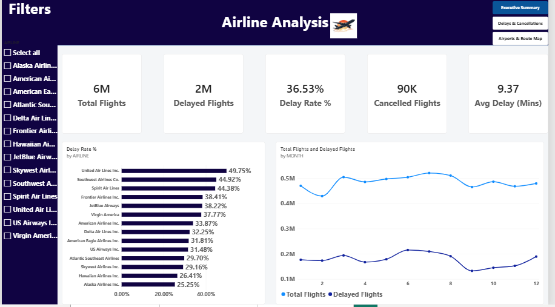
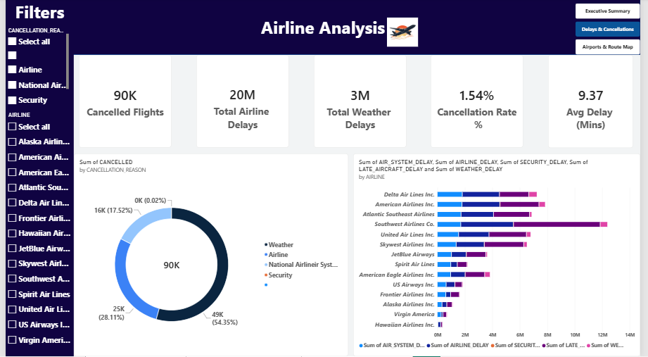
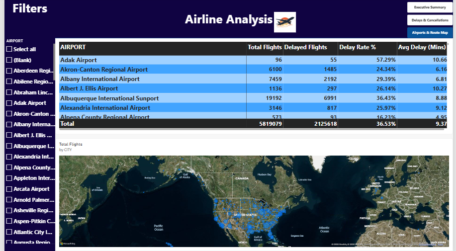

# ✈️ Airline Performance & Delay Analysis Dashboard

An interactive and comprehensive Power BI dashboard analyzing flight performance, delay causes, cancellation patterns, and airport geographic distributions.

---

## 📊 Dashboard Overview

The dashboard consists of 3 main pages designed with a sleek dark-themed header and intuitive page navigation:

1. **Executive Summary**: High-level overview of total flights, delayed flights, overall delay rate %, and monthly performance trends.
2. **Delays & Cancellations**: Deep dive into delay causes (Weather, Airline, NAS, Security, Late Aircraft) and cancellation reasons.
3. **Airports & Route Map**: Geographic map distribution of flight traffic and detailed metrics per airport.

---

## 📸 Screenshots

### 1. Executive Summary

### 2. Delays & Cancellations Analysis

### 3. Airports & Route Map

---

## 💡 Key Insights

- **Primary Delay Driver:** Late Aircraft and Airline Delays account for the majority of non-weather delay minutes.
- **Top Cancellation Cause:** Weather is the leading cause for flight cancellations (~54%).
- **Peak Delay Months:** Summer months experience a higher volume of total and delayed flights compared to early spring.

---

## 🛠️ Tools & Technologies Used
- **Power BI Desktop**: Data Modeling, DAX Measures, Custom Navigation & Visual Formatting.
- **DAX**: Created custom measures for `Delay Rate %`, `Cancellation Rate %`, and aggregated metrics.
